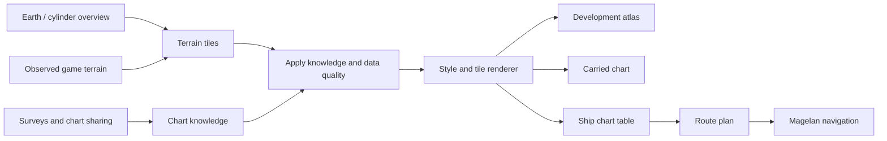

# Wmap: architecture and implementation plan

Prepared 2026-09-27. Proposal, not implemented behavior. Performance numbers below are design targets and calculations, not benchmark results.

Implementation update (0.3.0): the atlas, the semantic terrain pipeline and the automatically drawn chart style are built. Rather than the 256-pixel colour tiles proposed in section 5, the server bakes one whole-world semantic raster (coast distance, height, ice, river distance). The client draws it from a single mipmapped, wrap-addressed texture through a style shader, and adds semantic detail tiles only below the raster's resolution. Section 7's nautical style is implemented procedurally in that shader. Gameplay knowledge is a per-player exploration mask (section 6's "Exploration" preset). The [README](../README.md) describes the delivered behaviour; [testing](testing.md) records measured results. Physical charts, instruments, surveys, routes and the captain's table below remain a roadmap. The exploration mask is the intended place for survey results to write into.

## 1. Recommendation

Create Wmap as a standalone map mod with its own viewport, tile selection and built-in performance features drawn from Fast Map. Fast Map itself is not required. Share Wmap's rendering and chart model between a keyboard-opened atlas, a carried map, and a future captain's chart table. Keep Cylinder World, Earth Map, and Magelan optional integrations.

The central separation is:

1. **Terrain:** what the world contains, or what its generator predicts.
2. **Knowledge:** what this player or this particular chart has recorded.
3. **Presentation:** how that information is drawn.
4. **Access and navigation:** how a player opens a chart and obtains a position estimate.

Changing from a modern development map to a parchment chart must not require a different terrain engine. Changing a palette must not grant knowledge. Requiring a physical item must not automatically impose surveying mechanics; these are independent choices.

The first deliverable should be a development atlas with a whole-world button, smooth zoom, continuous east–west scrolling, visible latitude/longitude, and a visible distinction between predicted terrain and observed terrain. Physical items and realistic navigation follow after the map foundation works.

## 2. What the existing projects already provide

These findings come from the sibling workspaces inspected for this proposal. They describe the current source, not stable public integration APIs.

| Project | Existing foundation | Consequence for Wmap |
| --- | --- | --- |
| Cylinder World | `SeamParams` defines `JumpInset`, `WorldWidth`, `Circumference`, world length and polar geometry; `CylinderWorldCore.Params` is synchronized to clients. | Read the saved world's geometry. The playable ring is not necessarily the full engine map width. |
| Earth Map | `EarthGeometry` provides `ToGeo`, `FromGeo`, `WrapX`, ring geometry, a Pacific seam warp, and an inserted sea gutter. | Delegate geographic coordinates to Earth Map. A generic linear longitude formula would disagree near the seam and gutter. |
| Earth Map | `TerrainModel.GetColumn(x,z)` returns terrain/water information without generating a game chunk. `MapColors.Render` and `/earth map` already make an overview from it. | Reuse the model through a sampling adapter to build overview tiles. The current PNG export is evidence of feasibility, not the eventual map database. |
| Earth Map | The full terrain model is loaded server-side; the client's model is climate-only. | Plan a server tile provider. Do not assume the client already has a usable full terrain model. |
| Cylinder World | `/cyl map` samples a broad ocean/continent preview without generating chunks. | Useful fallback overview when Earth Map is absent; label it approximate. |
| Magelan | `EntityShip` owns server movement, helm input, collision checks, and waiting for unloaded terrain. Interior interactions use ship-local fixtures. | A chart table should become a fixture; route following should feed Magelan's controls and retain its movement checks. |

Local source references:

- [Cylinder geometry](../../Cworld/src/SeamParams.cs), [synchronization and preview command](../../Cworld/src/CylinderWorldCore.cs).
- [Earth coordinate conversion](../../Earth/src/Core/EarthGeometry.cs), [terrain sampling](../../Earth/src/Core/TerrainModel.cs), [overview rendering](../../Earth/src/Core/Png.cs), [server/client setup](../../Earth/src/EarthMapSystem.cs).
- [Ship movement and interaction](../../Magelan/src/Ship/EntityShip.cs), [ship fixtures](../../Magelan/src/Ship/ShipDefinition.cs).

The sibling projects target VS 1.22 and use a local build arrangement involving the game's .NET 10 assemblies and the installed .NET 8 SDK. Verify the precise installed game patch and supported build setup during the implementation spike; do not blindly reproduce that arrangement.

## 3. Relationship to existing map mods

Fast Map is a useful performance reference: it caches explored map pixels in larger pages and GPU atlases, and has an optional terrain-sampler overview. Its listing still recommends 122.5.2 and lists 122.6.0-dev.2 as a test build with background loading improvements. Those improvements may help today's map opening stalls, but they do not establish compatibility with this project's Earth generator or cylindrical navigation. [Fast Map listing](https://mods.vintagestory.at/fastmap)

Its current repository also documents a map-piece integration facade that could help a later optional import tool; verify its availability in the supported release. Wmap's renderer and cache will not call into Fast Map at runtime. Neither cached color pixels nor a generic terrain sampler can be assumed to contain Earth Map's semantic terrain, knowledge rules, or seam geometry. [Fast Map source](https://github.com/cjohnsto-nz/FastMap)

The selected Fast Map feature set becomes Wmap functionality:

| Performance feature to adopt | Wmap implementation requirement |
| --- | --- |
| Reusable terrain pages and compressed disk caching | Store Wmap's versioned terrain summaries and optional colors, with durable chart data separate. |
| GPU texture atlases | Batch visible map tiles while respecting explicit texture-memory and upload budgets. |
| Background loading | Load/decode/sample through bounded asynchronous queues; show coarse parents during refinement. |
| Incremental updates and coalesced saves | Update dirty regions and parent levels without repeatedly copying or saving all pages. |
| Cache limits and viewport prefetch | Keep memory bounded and prefetch a small margin in the likely travel/pan direction. |

Add Wmap's resolution pyramid, cylindrical transforms, semantic styles and chart knowledge around those capabilities. Reuse permitted implementation pieces where they fit; reimplement features where the existing pixel-page design does not fit. Before directly copying source, record its exact revision and applicable reuse terms/attribution. The repository pages reviewed here did not establish a code reuse license, so direct source reuse remains unverified; that does not block designing or independently implementing these features.

Frontier's Map provides physical maps and a manual editor with drawing tools and stamps. It is a useful visual and item-interaction reference; Wmap should generate coastlines and terrain symbols automatically. [Frontier's Map](https://mods.vintagestory.at/show/mod/53436)

Null Cartography offers a survey/notebook/table loop and local 256-block charts assembled into 1024-block regional charts. Its sextant interaction records a daylight survey while the player rotates; that is a different mechanic from a navigational position fix at sea. Borrow the idea of earning and transcribing observations, while designing chart scale and observations for long voyages. [Null Cartography](https://mods.vintagestory.at/nullcartography)

**Dependency decision:** no hard dependency on any of these three mods. Wmap is installed and tested with Fast Map absent. A separately keyed vanilla/Fast Map view can be useful for comparison during development, but coexistence is a separate compatibility test, not a prerequisite or a release promise. An optional read/import adapter for existing explored map data is a later migration feature; it must neither rewrite their databases nor imply support for their entire UI or mechanics. Review licensing before reusing external code or assets.

## 4. Viewport and cylindrical coordinates

Let `a = JumpInset` and `C = WorldWidth - 2 * JumpInset` on Cylinder World. Store terrain and ordinary positions in the canonical interval `[a, a + C)`. Use absolute game coordinates internally; spawn-relative HUD coordinates are a display conversion only.

```text
canonicalX(x) = a + floorMod(x - a, C)
displayX(x, cameraX) = canonicalX(x) + k*C
    where k selects the visible copy nearest the camera
```

The camera lives in continuous, unwrapped X coordinates. Panning east continues through successive copies of the ring. Store each terrain tile once and draw it at the necessary offsets. The north–south axis stays bounded; do not wrap the polar walls.

For ordinary movement sampled frequently enough, update a tracked position with:

```text
deltaX = floorMod(newCanonicalX - oldCanonicalX + C/2, C) - C/2
unwrappedPlayerX += deltaX
```

This handles routine seam crossing without a map jump. It cannot distinguish an arbitrary long teleport from normal travel. Add an explicit topology event for seam transfers with entity ID, signed wrap count and sequence; handle admin teleports, translocators, reconnects and dimension changes as discontinuities. Do not draw a voyage line through a teleport. Prefer explicit events for ship tracking, using the nearest-delta rule only as a fallback. Define the half-circumference tie consistently.

Apply the same transform to terrain, player/ship markers, labels, hover tests, waypoint placement, survey footprints and routes. Fixing only the terrain leaves interaction errors at the seam. A free-panned map should stay where the user put it until they enable follow mode or recenter.

At full-world zoom, show one circumference with the chosen center meridian and optional adjacent edge copies. The fit scale is the smaller of viewport-width/circumference and viewport-height/map-height, leaving padding. Zoom multiplicatively around the cursor so the same location stays under it. Render relative to a nearby camera origin to avoid float precision loss after repeated laps.

Tile boundaries must clip exactly at `a + C`. Do not wrap by `ceil(C/tileSpan) * tileSpan`: C need not be a multiple of the tile span at every resolution. Handle the final partial tile and wrapped border samples explicitly. Separate engine buffer terrain beyond the jump lines from the single logical ring.

Geographic labels and graticules use Earth Map's conversion, including its non-geographic gutter status. Cylinder World's simple longitude is a fallback for non-Earth cylinders. Distances and steering use game-world X/Z blocks: the playable world is cylindrical and Earth Map's vertical scale is transformed, so real-Earth great-circle routes and raw bathymetry do not directly describe ship travel or clearance.

### Visible latitude and longitude

Make latitude/longitude the normal coordinate presentation throughout Wmap: the map readout, selected waypoints, route legs, survey results and the future captain's table. Include an optional geographic HUD and a later adapter for the game's existing coordinate HUD. Raw X/Y/Z remains available as a developer display option.

Default formatting for immersion: **57° 00.0′ N, 24° 00.0′ E** (illustrative), with decimal degrees also available. Add a latitude/longitude grid with spacing that adapts to zoom, and accept geographic coordinates when adding a waypoint or route destination. Never display more measurement precision than the selected instrument/estimate supports.

Coordinate availability is independent of formatting:

- **Live:** current latitude and longitude are continuously visible, including in physical-map mode if desired.
- **Instrument:** visible while taking/reading a sextant fix.
- **Last fix / estimated:** show the last fix and its age, or a dead-reckoned estimate with uncertainty.
- **Hidden:** optional for players who prefer navigation entirely from landmarks.

Choose live geographic coordinates for the development/exploration defaults; the nautical preset may use fixes, but visible live latitude/longitude stays an explicit supported option. Displaying coordinates does not reveal terrain and requiring a physical chart does not automatically hide coordinates.

Use Earth's actual saved `ToGeo`/`FromGeo` conversion when Earth Map is active. In its inserted seam ocean there is no unique real-Earth longitude for every block: label the geographic result as seam-water/approximate instead of presenting it as an exact fix. A future continuous fictional-longitude scheme could cover that strip, but it must be a distinct coordinate datum. Without Earth, a cylinder can use its own equator/prime meridian. A plain world needs an explicitly configured geographic layout; do not invent Earth coordinates from spawn.

The E/W longitude label can wrap at the coordinate datum's ±180° boundary while the map camera and route remain continuous. This numeric wrap is independent of the displaced Pacific teleport seam. Store geographic references with their datum/topology version so saved destinations remain interpretable.

### Why a dedicated viewport

The published game source's `GuiElementMap.EnsureMapFullyLoaded` enumerates visible chunk coordinates, while its tracking code uses raw player-coordinate changes. Merely lowering the zoom limit would retain those costs and seam behavior unless the whole path is intercepted. For a 204800 × 102400 ring and 32-block chunks, full-world enumeration is about **20.48 million chunk positions**. Wmap's cost should depend on the screen's tile count instead. Verify the corresponding code in the installed game version before selecting integration hooks. [Game map viewport source](https://github.com/anegostudios/vsessentialsmod/blob/master/Systems/WorldMap/GuiElementMap.cs)

Use the game's GUI/rendering services around a Wmap viewport, with adapters for vanilla waypoints and permitted story/prospecting data. The game has a map-layer registry, but its layer interfaces are tied to the existing map element; do not promise automatic compatibility for arbitrary map layers. [World map manager source](https://github.com/anegostudios/vsessentialsmod/blob/master/Systems/WorldMap/WorldMapManager.cs)

## 5. Terrain pipeline and performance



Use 256 × 256 pixel tiles and a resolution pyramid, initially 1, 2, 4, 8, ... blocks per pixel. Choose a level near one rendered texel per screen pixel. Load visible tiles plus a small margin and display a coarser parent while finer tiles arrive. Keep tile requests, decoding and GPU uploads bounded even during rapid zooming.

At 128 blocks per pixel, a 204800 × 102400 ring becomes 1600 × 800 pixels: about **4.9 MiB of RGBA pixels**, excluding tile padding and other layers. Its one-pixel-per-block equivalent is about **78 GiB**. The overview is cheap because it uses a different resolution, not because the entire detailed world has been loaded faster.

Build coarse Earth tiles directly from the terrain model. Do not create all their fine descendants first. Accumulate observed detail only as it becomes available. For Cylinder World without Earth, begin with its coarse continent provider. With neither provider, still allow zooming to the whole map extent, but leave unknown terrain blank. Map extent and terrain revelation are independent features.

Keep compact semantic fields for style generation: surface/bed elevation, water classification, land/water coverage, ice, optional vegetation/climate, and quality/provenance. Keep actual sampled surface color as a separate optional channel for a true-color style. RGB-only imported data cannot reliably reconstruct depth or land cover.

Distinguish **predicted**, **observed**, **surveyed**, and **unknown** information. Earth sampling does not include every later worldgen operation, building or player edit; Cylinder World's polar modifications also need consideration. Near the player, observed terrain supersedes predictions according to the chart's update policy. Compare polar edges, seam water, rivers and structures explicitly before describing the overview as accurate.

At coarse levels preserve coverage and useful extrema. Simple color averaging can erase small islands and narrow channels. Use geometry/coverage rules to preserve cartographic features, and distinguish an unknown cell from known open water. A coarse tile must never certify safe passage for a ship.

Implementation rules:

- Snapshot game data on an API-safe thread; sample only immutable or explicitly thread-safe providers on workers. The current preview's use of parallel sampling is not a blanket guarantee that all live model state is safe.
- Separate disk I/O, sampling and decoding from main-thread GPU work. Cancel obsolete requests after view changes; reject stale responses by view/world generation IDs.
- Prioritize coarse visible tiles, then visible detail, then a small prefetch margin. Deduplicate equivalent requests across repeated ring copies and open views.
- Bound CPU/GPU caches with eviction and keep the whole-world overview resident where practical. Bound work queues and per-client network budgets too.
- Dirty only changed leaves and their ancestors. Coalesce edits and defer expensive parent/style rebuilds; avoid recooking an entire atlas each frame.
- Use versioned compressed tile blobs with an index, checksums and atomic/transactional writes. Cache corruption should trigger regeneration of affected derived tiles.
- Key source tiles by world ID, dimension, saved topology, provider/data version, tile level and canonical coordinates. Key derived chart/style tiles additionally by chart knowledge revision and style version. A seed alone is insufficient.
- Terrain caches are disposable. Survey records, chart revisions, annotations and routes are durable save data; purging a cache must preserve them.

Initial budgets to test on the user's machine: configurable 128 MiB CPU tile cache and 128 MiB GPU cache, about 1–2 ms of main-thread map work per frame, and a warm overview visible within 250 ms. These exclude game memory and server provider data. Bound first-run work and show progressive results; do not promise a fixed cold-start duration. Record frame-time percentiles, memory, queued jobs, disk reads and network bytes while sailing and zooming.

## 6. Modes, chart ownership and persistence

Presets configure independent axes rather than replace code:

| Preset | Opening the map | Terrain recording | Position display |
| --- | --- | --- | --- |
| Development | Hotkey; server-authorized developer access | Full predicted overview plus automatically refreshed observed detail | Exact position, coordinates, seam/debug overlays |
| Exploration | Hotkey | Automatically records permitted explored terrain | Exact or estimated, configurable |
| Physical exploration | Carried chart or table | Automatically records into the selected chart while exploring | Configurable; item access does not imply sextant use |
| Nautical survey | Carried chart or table | Observations and soundings transcribed automatically into chart content | Fixes and dead reckoning; optional exact marker for easier play |

Any preset may use any allowed visual style. Treat the world/server as authoritative for discovery and access policy; clients choose presentation and controls. A developer override must be explicit and scoped to the authorized player. Use Development for the initial local prototype; ship a general multiplayer default with exploration restrictions unless the owner selects otherwise.

The chart is a persistent document: `chartId`, world/dimension, topology revision, coverage/knowledge, observations, annotations, routes, owner/access metadata, and document revision. The item carries its document ID, not a giant terrain blob. Table views open that same document. Chart copying creates an independent snapshot unless the user deliberately chooses a shared crew chart.

Separate development knowledge from gameplay chart knowledge. Turning development mode off should select the gameplay chart again without filling it with everything viewed in the debug atlas. Keep permitted imported vanilla/Fast Map exploration in a separately identified source so importing it is a deliberate world/owner choice. Changing style or access requirements preserves existing charts; changing knowledge policy has explicit retention behavior and never silently erases them.

Server validation covers chart ownership, transfers, held tools, survey actions, sharing and route edits. Restrict tile responses to chart entitlement before transmitting private server-only information. Apply knowledge before reduction/style generation: parent tiles, coastlines, labels and filtering must not expose uncharted areas through blurred edges or inferred contours. Chart copies carry a frozen content revision or equivalent immutable references, so they do not silently refresh when a global terrain cache changes.

Do not conflate Wmap gameplay restrictions with hiding information from modified clients: the base game already sends nearby terrain. The aim is consistent mapping mechanics and appropriate server responses. Keep developer caches out of normal chart rendering.

Offer explicit options for minimap, player marker, coordinates, death markers, story/trader markers, and prospecting. Preserve legitimate quest navigation through compatible annotations or chart clues. Decide runtime versus next-load changes per setting. Avoid a persistent surprise change to the world's `allowMap` setting; manage Wmap's access and hotkeys explicitly and restore temporary handlers when leaving a world.

## 7. Automatically generated nautical style

Generate the appearance from terrain and knowledge, with style assets and parameters separate from saved chart content:

- Parchment background, ink coastlines, subtle shallow-water bands and a restrained water wash.
- Simplified contours or hachures for relief; optional deterministic mountain/tree symbols where terrain supports them.
- Surveyed soundings, port and hazard symbols, graticules, compass rose, labels and plotted courses.
- Uncharted parchment, incomplete coastlines and uncertain position marks to communicate missing knowledge.

A grayscale/sepia filter alone will not give convincing nautical cartography. Extract contours and coastlines from semantic data, simplify by zoom level, and layer symbols over the raster base. Cache that work. Start with coastline plus shallow-water fill; add hachures and symbols after the first style is usable.

Use canonical-world seeds and wrapped neighbor samples for decorative variation and contours. The same location should look the same across tile edges, the cylinder seam and repeated views. Use screen-space label/symbol density limits and stable feature selection to avoid flicker when zooming.

Proposed initial styles: terrain/development, simple topographic, and nautical parchment. A style manifest declares palette, textures, symbol set, contour intervals and label rules. Ship original or appropriately licensed assets. No player drawing is needed for the base chart; optional annotations remain useful.

## 8. Surveying while sailing

Keep **learning where you are** separate from **learning what is around you**.

A proposed voyage loop:

1. Select a chart at the ship's table and plot the intended route over known water.
2. Take a timed sextant observation on deck to establish or improve an estimated position.
3. Record visible coast/landmark observations as the ship travels. Higher viewpoints and good visibility can improve coverage; automatic recording is configurable.
4. Plot an estimated track between fixes using heading and speed; uncertainty grows with travel and instrument quality.
5. Take another fix to correct the estimate and register recent observations. The chart draws surveyed coasts automatically.
6. Near shore, take lead-line soundings to record actual depth where measured. In strict survey mode, ocean depth is not granted by a sextant sighting.

On a featureless ocean, a position fix and the voyage track are still useful even when no coastline can be recorded. A fix should not reveal a disk of seabed or distant land. World-scale zoom remains available, showing the full chart extent with unknown regions blank.

For the first version, use an explicitly simplified timed-fix mechanic with configurable accuracy and conditions. A later celestial-navigation mode would need a defined sky/time model, observation equations and the Earth seam/gutter conversion. Do not label a generic coordinate reveal as realistic celestial navigation.

Null Cartography's stationary survey should not be copied literally onto a moving deck. Validate the observer's stance relative to the ship; ordinary ship translation must not cancel every observation. Set tolerances for turning/motion, accumulate observation time, and let the server calculate the result. Use loaded terrain and bounded visibility queries for coastal surveying, not an unbounded scan of generated terrain.

Store an observation's time, estimated position/error, bearings/range information, type and source. Raw observations can later be registered more accurately after another fix without requiring the player to redraw the coastline. Suggested gameplay balance defaults remain tunable until sea trials.

## 9. Captain's table and route following

Reserve these data contracts now; implement the physical table and controller after Magelan's ship behavior is ready.

The table is a Magelan ship fixture with a chart/document binding. Its interaction opens the same map renderer; a later in-world table surface can render that view to a texture at a lower refresh rate. Map data stays in world coordinates while the furniture moves in ship-local space.

Wmap owns route editing, storage, leg visualization and sharing. Magelan owns acceptance of a route, active-leg progress, steering, sails, collision/grounding checks, stopping and persistence of navigation state. Supply a route through a narrow versioned API rather than have the map write entity positions or continuously set raw rudder values.

A route contains world/topology ID, chart provenance, revision, waypoints, arrival radius/corridor, and a signed winding choice for each leg. Store canonical coordinates plus winding; screen coordinates are never route coordinates. Choosing only the nearest waypoint copy loses the intent of a deliberately eastbound or long-way voyage. Seam crossing should advance continuous route progress without drawing a line across the entire map or selecting the opposite heading.

Separate route plotting from engaging navigation. Start with following manually placed legs in known open water. Automatic obstacle-aware passage planning comes later and needs ship width, draft, turning radius and data quality. The map's low-resolution land/depth colors are insufficient for that job.

Magelan's controller should have explicit idle/following/paused/completed/blocked states, immediate manual override, and defined behavior for missing chunks, grounding, route edits, chart transfer, disconnects and restart. Respect its current unmanned-stop behavior by default. In strict nautical mode, steering uses the configured navigation estimate; exact engine coordinates remain available for collision checks without silently making the chart marker perfect.

## 10. Proposed module boundaries

Use one initial Wmap package with internal modules. Split optional adapters into separate assemblies/packages only when version compatibility makes that useful.

| Module / proposed contract | Responsibility |
| --- | --- |
| `Core.Topology` / `IWorldTopology` | Canonical positions, bounded axes, displacement, repeated views, topology identity. |
| `Core.Geography` / `IGeographicTransform` | Optional latitude/longitude conversion and unsupported/gutter status. |
| `Terrain` / `IMapTerrainProvider` | Versioned tile/summary requests, source quality, cancellation and update notifications. |
| `Knowledge` / `IChartKnowledgeService` | Exploration/survey policy, permissions, chart coverage and revisions. |
| `Charts` / `IChartRepository` | Durable charts, observations, annotations, copies and routes. |
| `Rendering` / `IMapStyle` | Tile pyramid composition, caches, contours, symbols and labels. |
| `Client` / `MapViewport` | Camera, zoom, hit testing, follow modes and atlas/chart/table views. |
| `Navigation` / `INavigationEstimateProvider` | Exact/fix/dead-reckoned position and uncertainty, according to policy. |
| `Integrations` | Cylinder World, Earth Map, vanilla annotations/data, optional Fast Map imports and Magelan. |

These are proposed contracts, not APIs claimed to exist in the current mods. Prefer explicit adapters with a small shared contract package over scattered reflection. If the prototype needs reflection for optional dependencies, centralize version/shape checks and fail with a clear disabled-integration status.

Suggested protocol categories are topology/policy handshake, bounded tile requests/responses, chart revision updates, survey actions, and route submission. Every message includes the relevant world/document revision so late packets cannot populate a different world or chart. Actual message schemas should be fixed after the first integration spike.

## 11. Implementation stages and acceptance gates

| Stage | Deliverable | Gate before proceeding |
| --- | --- | --- |
| 0 — integration spike | Confirm game build, GUI hooks, server Earth sampling, saved Cylinder geometry, Fast Map feature/reuse inventory and clean shutdown. Compare a custom view with the current map on one test world. | Standalone startup with Fast Map absent; no visible-chunk enumeration at whole-world scale; no chunk generation requested solely for overview tiles. |
| 1 — development atlas, v0.1 | Independent hotkey, whole-world fit, cursor zoom, continuous X camera, Earth/cylinder overview, observed-detail source, built-in page cache/loading, exact marker, visible latitude/longitude and diagnostic counters. | Full-ring view stays interactive; repeated seam crossings and reconnects work; geographic labels match the Earth provider; cold data loads progressively; all work cancels on leave. |
| 2 — map content and styles, v0.2 | Semantic summaries, terrain/topographic/nautical styles, waypoints and selected vanilla annotation adapters. | Same locations align across styles and seam; style changes preserve content; quest and prospecting workflows are checked. |
| 3 — chart policies, v0.3 | Exploration and physical exploration presets, chart identity/copying, item access, server policy and separate development access. | Switching modes preserves charts; debug data does not appear in survival documents; two players can own distinct copies. |
| 4 — nautical surveys, v0.4 | Timed fixes, moving-deck surveys, automatic chart drawing, estimated track/uncertainty, soundings and transcription. | A sea voyage creates a useful chart without manual drawing; surveys work aboard a moving ship and do not reveal unseen terrain/depth. |
| 5 — ship table and route handoff | Magelan fixture, route editing and explicit navigation engagement, then open-water leg following. | Seam-crossing routes keep direction; manual control cancels navigation; grounding/unloaded terrain/unmanned handling remains effective. |

Start validation with the current recommended 256000 × 102400 engine world (204800-block ring), then a larger world and a small synthetic wrap test. Validate both single player and a dedicated server before claiming server support.

Focused regression cases for the nontrivial implementation:

- Wrap just below/at/above each jump line, negative display X, many laps, half-ring ties, partial edge tiles, planar fallback and bounded Z.
- Earth coordinate round trips outside the gutter, explicit gutter handling, Pacific seam warp, poles and saved older geometry.
- Geographic readouts in degrees/minutes and decimal degrees, E/W datum wrapping without camera jumps, precision/uncertainty and live-versus-instrument policy independent of chart access.
- Zoom from block detail to planet and back while moving; no full-detail world allocation and no stale tile publication after disconnect.
- Tiny islands, narrow rivers, shallow water, unknown cells, partial-chart tiles and contours at both tile and world seams.
- Observed edits overriding predicted terrain; chart snapshot copies retaining their intended contents after later observations.
- Player, ship, labels, hit tests, waypoint edits and multi-leg routes all resolving to the same visible seam copy.
- Survey/ownership checks on the server, mode switching, chart transfer/copy and mismatched revisions.
- Route restart, manual override, long-way legs, missing chunks and a ship crossing the seam while the table is open.

Benchmark the same camera path with cold and warm caches. Measure first visible coarse terrain separately from complete fine-detail loading. Include continuous sailing so map workers cannot hide their cost behind a paused game.

## 12. Decisions carried forward

Proceed with standalone Wmap incorporating the selected Fast Map performance features; a dedicated renderer and viewport; visible latitude/longitude with configurable readout rules; versioned adapters to the existing world/ship mods; a server-provided Earth overview; independent chart knowledge and styling; and the development atlas as the first implementation target.

Defer exact sextant balance, optional notebook consumables, historical celestial calculations, final art direction, automatic water-route planning, and rendered tabletop geometry until their corresponding stages. None should block the world-scale map foundation.

The remaining technical uncertainties to resolve first are the installed game patch's hooks, the minimal safely exposed Earth sampling contract, server sampling/network costs, and vanilla annotation compatibility. There is no working Wmap build or measured performance result at this design stage.

This plan predates the first build. Implemented decisions, with their reasons and the release that made them, are kept in [decisions.md](decisions.md); support for other terrain generators is analysed in [terrain-generators.md](terrain-generators.md).
